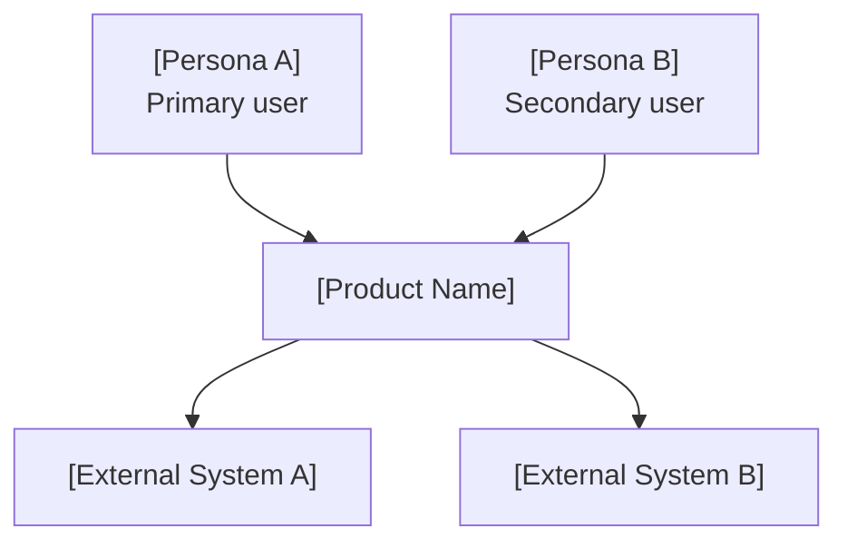
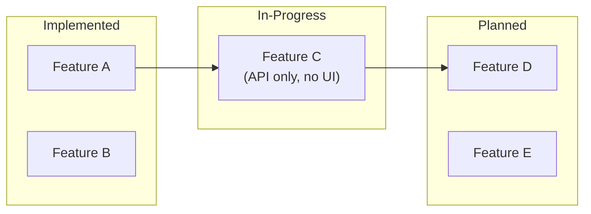
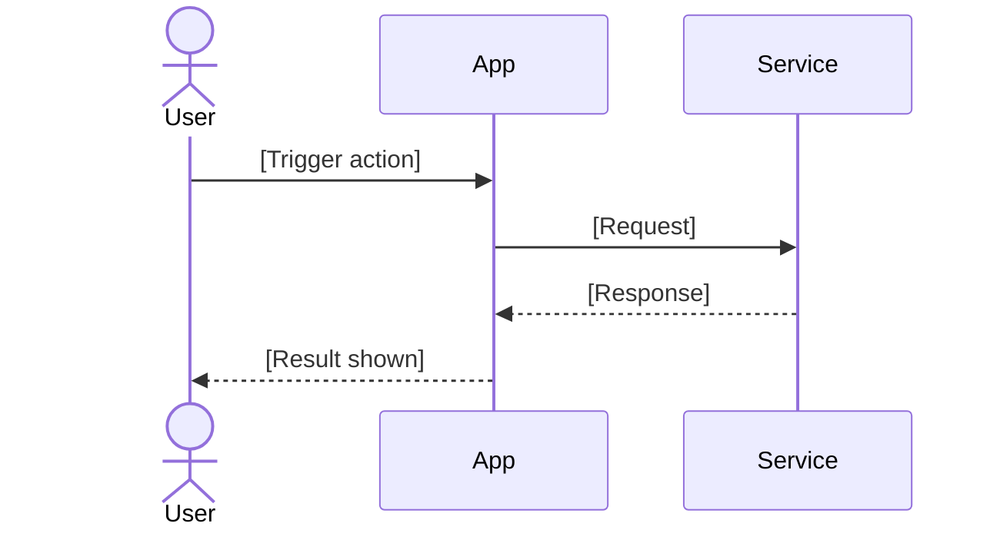

# Rich Output Examples

Last updated: 2026-10-23

Load only for the active artifact. The [skill procedure](../SKILL.md) (reference procedure; capability not installed) and domain contracts govern; examples do not create authority.

Show who uses the system and what external systems it connects to. Use a C4-style or simple
flowchart — whichever is clearer for the specific product.

Include only systems that are real and named. Don't invent integrations.

### Mermaid: Feature Status Map

Show what is implemented, in-progress, and planned. Use subgraphs or node styles to distinguish
status. Derive this directly from current capability records.

Omit this diagram when there is no existing-product baseline. For greenfield complex systems,
use a feature dependency map instead — which features must ship before others can.

### Mermaid: Primary User Journey

The core scenario as a diagram. Use a sequence diagram for multi-party interactions
(user ↔ system ↔ external service). Use a flowchart for single-user decision flows.

Keep it to the primary scenario. Secondary scenarios get a brief prose note, not a second diagram.

### HTML Demonstration (optional)

Generate a self-contained HTML page when the product is UI-heavy and a static mockup
communicates the key interaction better than prose or a diagram.

Rules:
- Fully self-contained: no external CSS frameworks, no CDN script tags, no remote fonts
- Inline all styles; inline any JavaScript
- Demonstrate the primary scenario only — the one action that produces the "Aha!" moment
- Label it "Design Demo — [YYYY-MM-DD]" so readers know it is illustrative, not production
- Use realistic data, not Lorem Ipsum placeholders

Skip the HTML demo entirely when the product is a CLI, API, background service, or data pipeline.
